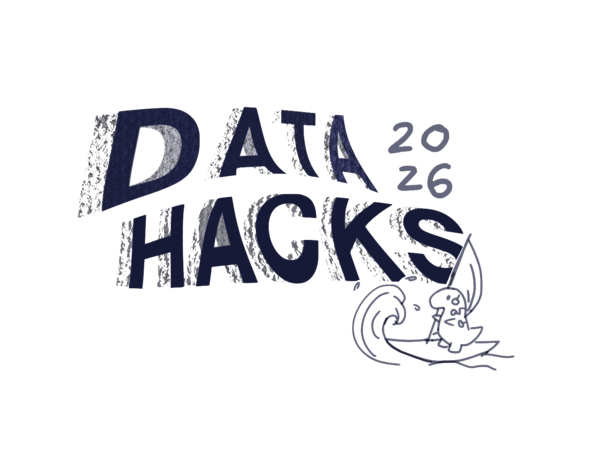
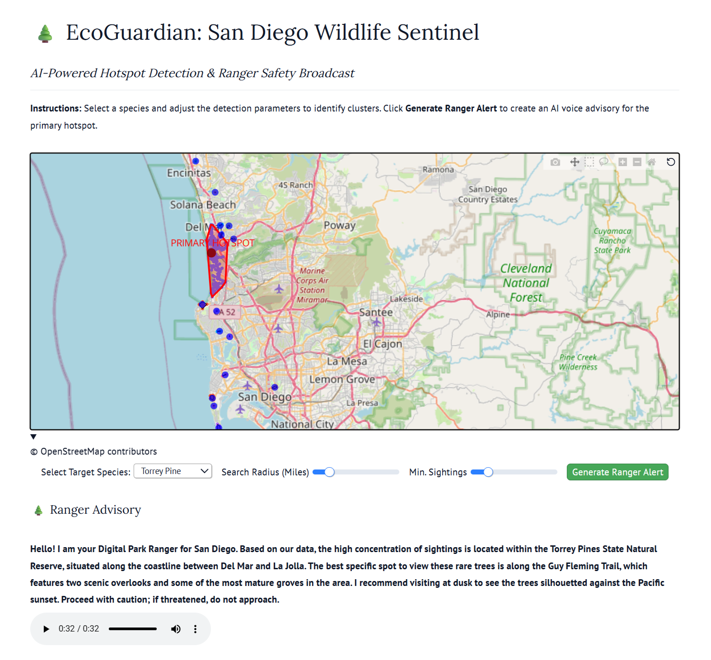

# EcoGuardian

<div align="center">
  <table border="0" cellpadding="0" cellspacing="0">
    <tr>
      <td align="center" valign="middle">
        
      </td>
      <td align="center" valign="middle" style="padding: 0 20px;">
        <span style="font-size: 24px; font-weight: bold;">✕</span>
      </td>
      <td align="center" valign="middle">
        
      </td>
    </tr>
  </table>
</div>

<p align="center">
  🏆 <b>DataHacks 2026 — 3rd Place Winner</b><br>
  <i>Challenge: Best use of Marimo / Sphinx</i><br><br>
  <a href="https://devpost.com/software/ecoguardian-lf5qjx">
    
  </a>
</p>

---

EcoGuardian is an environmental monitoring and threat-detection dashboard designed to analyze ecological observation datasets, track field metrics, and deliver alert triggers for wildlife conservation and park rangers.

---

## Dashboard Preview

<p align="center">
  
</p>

### Key Highlights
* **Award-Winning Marimo Integration**: Developed the core application using Marimo for reactive state management and efficient parameter tuning, which helped secure 3rd Place at DataHacks 2026.
* **Ecological Observation Tracking**: Designed interactive visualizations to monitor and analyze structured observation data sourced directly from field records.
* **Threat Alert System**: Integrated an automated audio notification system (`ranger_alert.mp3`) that triggers whenever incoming environmental data crosses critical anomaly thresholds.
* **Historical Data Analysis**: Configured the dashboard to process historical archive data (`cce2_archive`), enabling seamless comparisons between current ecological trends and established baselines.

---

## Repository Contents

```text
├── Dropdown Observations/     # Category observation datasets and records
├── assets/                    # Web bundle scripts and styling for the static build
├── EcoGuardian-dashboard.png  # Interface screenshot preview
├── README.md                  # Project documentation
├── ecoguardian.py             # Main Python dashboard application
├── index.html                 # Standalone static dashboard build
├── ranger_alert.mp3           # Ranger alert audio trigger
├── logo.png                   # Primary branding asset
├── manifest.json              # Web app manifest configuration
├── site.webmanifest           # PWA deployment manifest
└── [favicons & app icons]     # Browser, Android, and Apple icon assets

```

---

## Getting Started Locally

### 1. Clone the Repository

```bash
git clone [https://github.com/](https://github.com/)<your-username>/<your-repo-name>.git
cd <your-repo-name>

```

### 2. Set Up a Virtual Environment

**Windows (PowerShell):**

```powershell
python -m venv venv
.\venv\Scripts\Activate.ps1

```

**macOS / Linux:**

```bash
python3 -m venv venv
source venv/bin/activate

```

### 3. Install Dependencies

```bash
pip install marimo

```

### 4. Run the Dashboard

To run the application in presentation mode:

```bash
marimo run ecoguardian.py

```

To run the application in interactive editing mode:

```bash
marimo edit ecoguardian.py

```

The application will launch automatically in your browser at `http://localhost:XXXX`.

---

## Links & Submission

* **Devpost Project**: [EcoGuardian on Devpost](https://devpost.com/software/ecoguardian-lf5qjx)
* **Event**: DataHacks 2026

```

```
